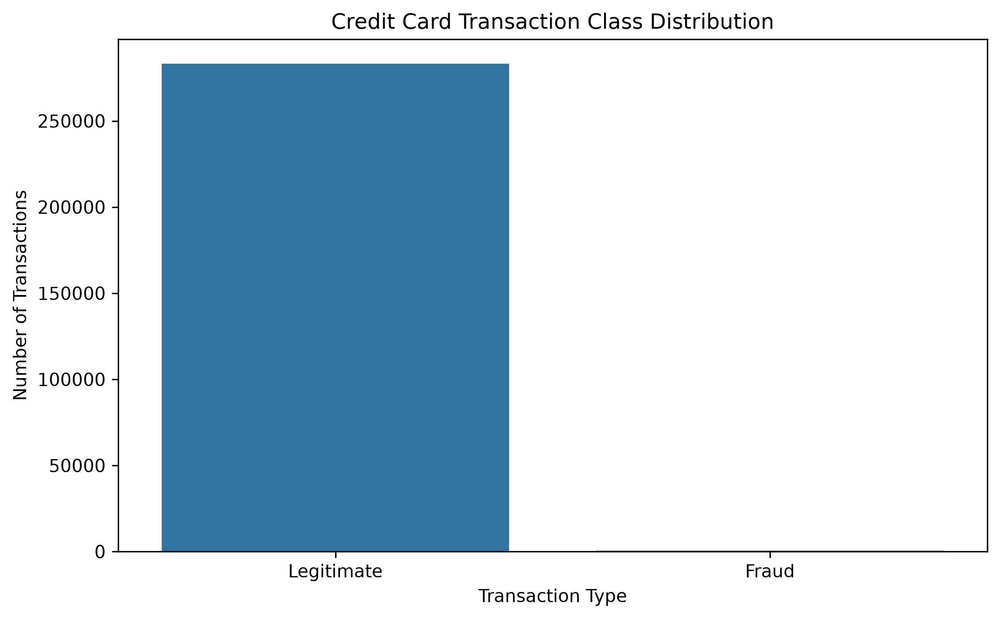
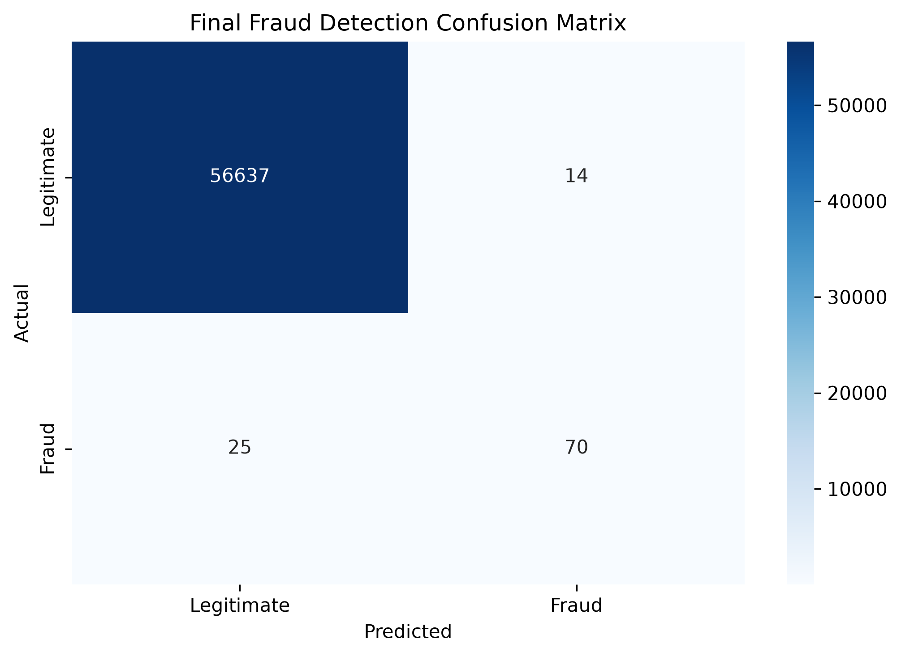
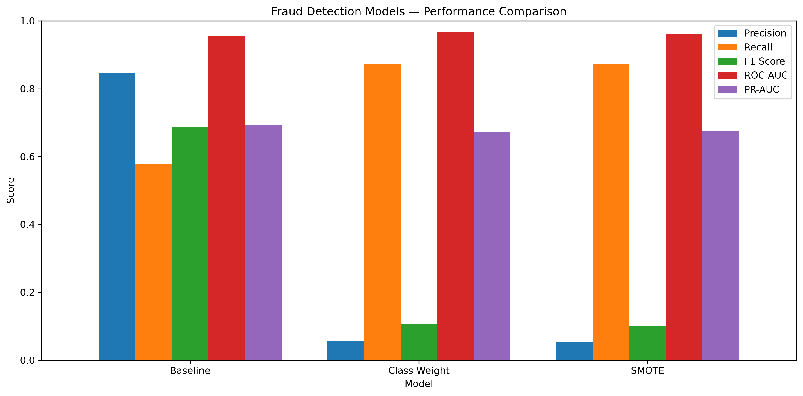

# Credit Card Fraud Detection with Imbalanced Data

A Machine Learning project that identifies potentially fraudulent credit card transactions using Logistic Regression, class-imbalance handling techniques, probability threshold tuning, and an interactive Streamlit web application.

## Project Overview

Credit card fraud detection is a challenging classification problem because fraudulent transactions represent a very small percentage of all transactions.

This project explores imbalanced classification techniques, evaluates model performance using fraud-focused metrics, and integrates the trained model into a web application for interactive predictions.

## Features

- Exploratory Data Analysis (EDA)
- Class distribution and transaction analysis
- Logistic Regression baseline model
- Class weighting and SMOTE experiments
- Probability threshold tuning
- Model evaluation and confusion matrix
- Saved model and preprocessing artifacts
- Interactive Streamlit web application
- Transaction fraud probability and classification result

## Dataset

**Dataset:** [Credit Card Fraud Detection — Kaggle](https://www.kaggle.com/datasets/mlg-ulb/creditcardfraud)

The dataset contains 284,807 transactions and 30 input features.

- `Class = 0`: Legitimate transaction
- `Class = 1`: Fraudulent transaction
- Total fraudulent transactions: 492
- Fraud rate: approximately 0.173%

Features `V1` through `V28` are anonymized numerical features produced using PCA. The dataset also contains `Time` and `Amount`.

Download the dataset from Kaggle and place `creditcard.csv` in the location expected by the notebook.

## Technologies Used

- Python
- Pandas and NumPy
- Scikit-learn
- Imbalanced-learn (SMOTE)
- Matplotlib and Seaborn
- Joblib
- Jupyter Notebook
- Streamlit

## Machine Learning Workflow

1. Load and inspect the dataset.
2. Perform exploratory data analysis.
3. Check missing values and duplicates.
4. Split the data into stratified training and test sets.
5. Scale features using StandardScaler.
6. Train a Logistic Regression baseline.
7. Compare class weighting and SMOTE approaches.
8. Evaluate Precision, Recall, F1-score, ROC-AUC, and PR-AUC.
9. Select a classification threshold using validation data.
10. Save the model, scaler, feature names, and threshold.
11. Build a Streamlit interface for interactive predictions.

## Final Model Performance

The selected Logistic Regression model uses a classification threshold of `0.1`, selected through validation experiments.

| Metric | Test Result |
|---|---:|
| Precision | 83.33% |
| Recall | 73.68% |
| F1-score | 78.21% |
| ROC-AUC | 95.60% |
| PR-AUC (Average Precision) | 69.20% |
| True Positives | 70 |
| False Positives | 14 |
| True Negatives | 56,637 |
| False Negatives | 25 |

On the held-out test set, the model identified 70 of 95 fraudulent transactions and missed 25. It also incorrectly flagged 14 legitimate transactions.

These results demonstrate the trade-off between detecting fraud and generating false alarms. Because the dataset is highly imbalanced, precision, recall, F1-score, and PR-AUC are important evaluation metrics.

## Web Application

The Streamlit application provides:

- A transaction feature input form
- Fraud probability estimation
- A configurable decision threshold stored with the trained model
- A Fraud Alert or Legitimate Classification result
- A simple interactive interface for demonstrating the model

The application is intended as an educational portfolio demonstration. Its predictions are estimates, not proof that a transaction is fraudulent or legitimate.

## Project Structure

```text
fraud-detection-imbalanced-data/
├── app.py
├── fraud_detection.ipynb
├── README.md
├── requirements.txt
├── .gitignore
├── images/
│   ├── class_distribution.png
│   ├── confusion_matrix.png
│   └── model_comparison.png
└── fraud_detection_artifacts/
    └── [local model artifact — not committed]
```

The image files should be included if they have been generated. The trained Joblib artifact is kept locally and is not included in the public repository.

## Run Locally

### 1. Clone the repository

```bash
git clone https://github.com/alimuhammad-007/fraud-detection-imbalanced-data.git
cd fraud-detection-imbalanced-data
```

### 2. Create and activate a virtual environment

Windows PowerShell:

```powershell
python -m venv .venv
.\.venv\Scripts\Activate.ps1
```

### 3. Install dependencies

```bash
pip install -r requirements.txt
```

### 4. Prepare the model artifact

Create the `fraud_detection_artifacts` directory and place your locally saved `fraud_detection_model.joblib` file inside it.

The artifact must contain the trained model, fitted scaler, decision threshold, and feature names expected by `app.py`.

### 5. Launch the web application

```bash
streamlit run app.py
```

Streamlit will display a local URL, usually `http://localhost:8501`. Open it in your browser to use the application.

### 6. Run the notebook

Open `fraud_detection.ipynb` in Jupyter Notebook and run its cells in order. Download the dataset separately from Kaggle.

## Visual Results

### Class Distribution



### Confusion Matrix



### Model Comparison



If these image files have not been generated or committed yet, create and upload them before relying on these README image previews.

## Limitations

- The `V1`–`V28` features are anonymized PCA-transformed values.
- The threshold reflects a validation-based choice and may not suit every business use case.
- Model probabilities are not guaranteed to be calibrated risk estimates.
- Results from one train/test split may not generalize to future transactions.
- The application has not been validated for production financial decisions.

## Future Improvements

- Compare additional classification algorithms.
- Improve the user interface and deployment experience.
- Evaluate probability calibration and precision-recall curves.
- Monitor model performance and changes in transaction patterns.
- Validate performance on additional datasets and time periods.

## Author

**Ali Muhammad**

AI & Data Science | Machine Learning

GitHub: [alimuhammad-007](https://github.com/alimuhammad-007)

---

This project was developed for learning and portfolio demonstration purposes.